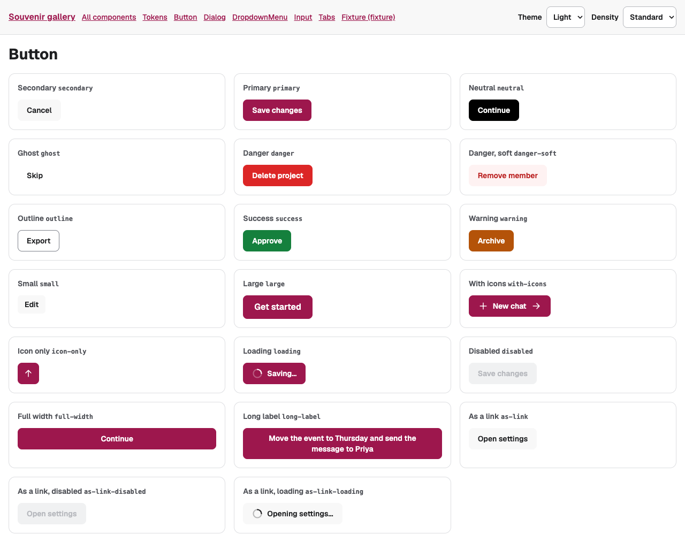
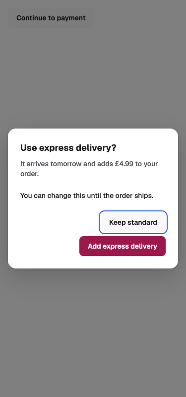
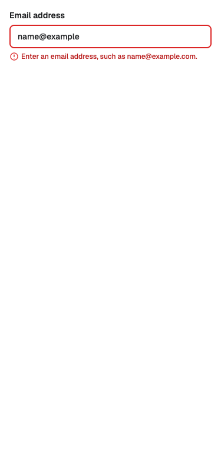
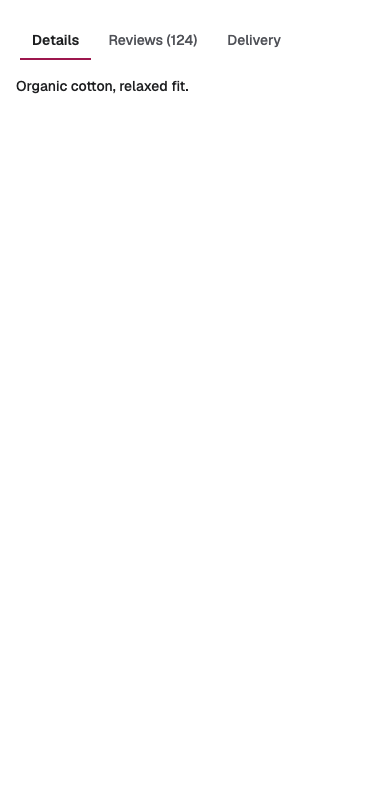
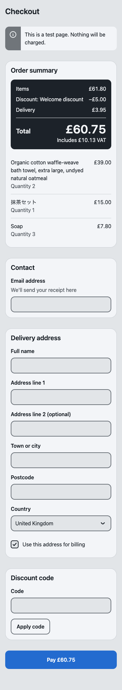
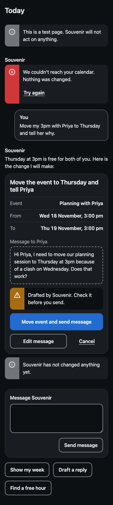
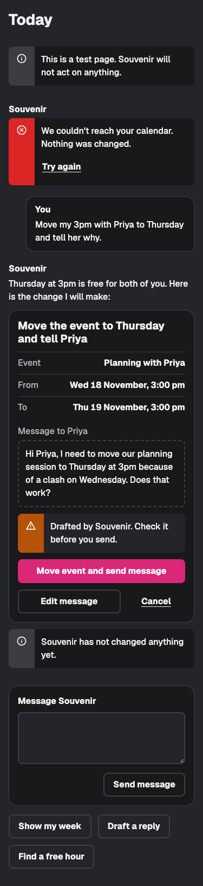
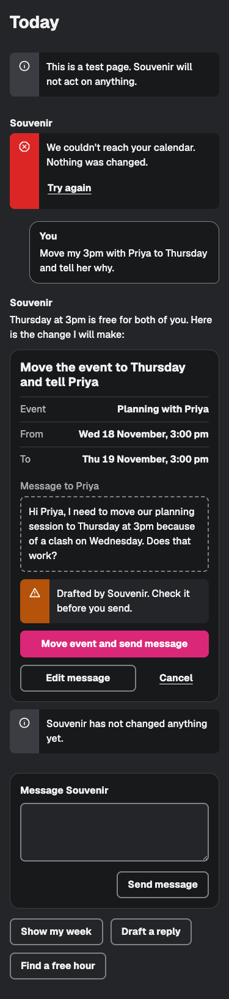

# Morning summary: the V2 direction, 16 November 2026

Your V2 direction is now a working chain on the branch `v2-direction`: an exact copy of your Figma tokens, a gate that checks them, a token package, five specified and built components, and the same thing rebuilt in your sandbox Figma file. Main is untouched. Your Semantic Tokens and Primitives files were read and never changed.

**To look at it**

- The report page, built from the tools' own numbers: `v2/report/index.html` (opens from disk).
- The three directions on real screens: run `npm run serve`, then open `http://localhost:4174/v2/screens/index.html`.
- The components: `npm run v2:gallery`, then `http://localhost:4174/ds-components/gallery/dist/index.html`.
- In Figma, in Souvenir-test: the pages "DS V2 · Tokens", "DS V2 · Components" and "DS V2 · Screens", each ending "(added by Claude)".

## Three decisions for you

1. **Put the fixes into your real Figma files.** 77 alias changes, 23 new variables and 290 descriptions are listed in `ds-tokens/audit/figma-patch-list.md`, each with its reason. I applied the same set in the sandbox, and the tools prove Figma and code then agree on 329 of 329 tokens. *Default taken: your files are unchanged; the repo carries the fixes in `ds-tokens/overrides.json` and `ds-tokens/proposed/`.* Say "apply it" and whether I may edit Semantic Tokens, or apply the list by hand.
2. **Pink beside red.** In dark, the primary fill (pink/600) and the destructive fill (red/600) have nearly the same lightness and chroma and sit 27 degrees of hue apart. *Default taken: pink stays as you chose it, and the system stops relying on hue:* a destructive button names what it destroys, a soft destructive variant differs in shape, errors carry an icon and words. If you would rather move one of the two colours, say which.
3. **Finish the renames your own standard asks for, now or later.** The Figma file breaks its naming standard in 24 places: radius named by height, type roles named small and base, typography prefixes that Tailwind will not turn into classes, collections not named for their category. Renaming is a breaking change, and cheapest before engineers build. *Default taken: nothing renamed; code uses the names Figma has today.*

## The token audit

| | As Figma stands | With the repo's fixes |
|---|---|---|
| Colour pairs that fail contrast | 215 of 726 | 0 of 734 |
| Pairs exempt, each with a reason (disabled, dividers) | 52 | 52 |
| Naming findings | 66, of which 24 break the standard | 49 in the sandbox copy, of which 14 break it |
| Figma and code agree | 261 of 308, the other 47 being the fixes | 329 of 329 against the sandbox |

- **How a pair is chosen:** the token names say what meets what (text on the three surface tiers in every state, labels on fills, icons, control edges, the focus ring). The list is `v2/tools/contrast-pairs.json`.
- **Every fail fixed or explained:** each fix is the nearest step on the same colour ramp that passes every pair the token is in. The full grid, before and after, is `ds-tokens/audit/contrast.html`.
- **Your own figures reproduce:** brand text in dark 3.83, teal and blue bold text on hover 3.32 and 4.24, placeholder 3.24.
- **What your weak-spot list did not have:** accent text in dark was as low as 1.3 to 1; bold accent icons in dark were the 900 step on a 900 surface, 1 to 1; the subtle neutral surface in dark was a light grey with text of the same grey on it.
- **Edge of an input:** `border/primary` is 1.35 to 1 against the page. It stays a divider; a new `border/strong` is the edge of a control.

## The five components

Each has a spec (`ds-components/specs/`), a stylesheet and typed props generated from it, a React component on Radix, examples, and a browser test for every requirement that names one.

| Component | Checks passed | Failed | Not reached, or for a person |
|---|---|---|---|
| Button | 635 | 0 | 2 |
| Input | 670 | 0 | 5 |
| Tabs | 682 | 0 | 3 |
| Dialog | 453 | 0 | 43 |
| DropdownMenu | 582 | 60 | 5 |

- **What a check is:** the runner opens every example in a real browser, in light and dark, at 320 and 1280 pixels. It drives each state the spec lists and compares the rendered colour with the token the spec names. It runs axe, measures contrast, target size and the focus ring, and runs 129 tests that requirements name, such as "Escape closes the dialog and focus returns to the trigger".
- **The 60 failures are one finding.** Radix's default modal mode for a menu hides the page root from assistive technology while the trigger inside it can still take focus (axe rule `aria-hidden-focus`). It is left failing. Switching the default to non-modal removes it but uncovers a naming mismatch on items that have a description; both are measured in `notes/sources/raw/2026-11-16-v2-integration-returns.json`. This one is Kunal's call.
- **Dialog's 40 "not reached":** Radix removes a closed dialog from the page at once, so its closed state cannot be seen. The runner says so instead of counting it as a pass.
- **States mapped to Radix attributes:** `ds-components/docs/state-map.md`. Tabs selected is `[data-state="active"]`; a menu item's hover and focus are one state, `[data-highlighted]`; Input's Figma states placeholder, filled and error map to `:placeholder-shown`, its negation and `[data-invalid]`.

| Menu | Dialog | Input | Tabs |
|---|---|---|---|
|  |  |  |  |

## The same screens in three directions

Version 0.2's checkout and assistant, as built; with your V2 tokens as Figma holds them; and with the merged tokens. All 24 measured page states pass text contrast and control-edge contrast.

| Version 0.2 | V2 as given | Merged |
|---|---|---|
|  |  |  |
|  |  |  |

**An honest result:** on these two screens "as given" and "merged" look almost the same. The tokens that fail in Figma (status text, accent text, placeholder, links on grey) are ones these screens barely use. The fixes show on the components and on the token page, not here.

## In your sandbox, Souvenir-test

**Added, and nothing that was there before edited or deleted** (full list with ids: `v2/figma/sandbox/CHANGES.md`):

- 12 variable collections, 521 variables, named "… (DS V2)" and "… (DS V2 primitives)". Every semantic variable has a description, web code syntax and fitting scopes; primitives are hidden from pickers.
- 2 effect styles, "shadow/md (DS V2)" and "shadow/lg (DS V2)".
- Page "DS V2 · Tokens (added by Claude)": every colour role in light and dark, the type, radius and spacing scales.
- Page "DS V2 · Components (added by Claude)": Button (114 variants), Input (21), TabsTrigger (20), DropdownMenuItem (14), DialogContent (2), three menu parts and nine icons, generated from the specs. A read-back found all 3,623 bindings on the variable the spec names, and no raw value.
- Page "DS V2 · Screens (added by Claude)": the two screens above, each in light and dark.
- Later the same day I renamed two of my own new variables, `focus/width` and `focus/offset`, to `ring/width` and `ring/offset`.

One thing I read differs from what you said: the variable Background/Inverse in Souvenir-test is `#000000` in light, not `#0040ff`. The blue may be set by hand on layers.

## Your direction and mine, and the merge

The full table, topic by topic, is in the report page and `v2/report/comparison.json`. In short:

- **Yours is stronger on:** the vocabulary (308 tokens in the product's own words against 68 in mine), writing a name once in Figma, the choice of first components (the five the app uses most), and the brand.
- **Mine was stronger on:** a gate that stops a bad value shipping, contrast, the edge of a control, tokens for border widths, sizes and motion, and proof in a browser that a component does what its description says.
- **Merged:** your names and values, unchanged, as the public names; my gate between Figma and code; a spec per component from which styles, types, docs and tests are generated.

**What hurts accessibility, agent-readiness or the build, in your direction as given:**

- **Accessibility:** the 215 failing pairs; the input edge at 1.35 to 1; body text at 14 pixels in a text field, which makes iOS zoom the page (the merged Input uses 16 on a touch screen); controls 32 and 40 pixels tall on a phone (merged: at least 44 where the pointer is a finger); 10 pixel type roles.
- **Agent-readiness:** no token has a description, which is what an agent reads through the Figma connector (drafted: 290, in `ds-tokens/descriptions.json`); typography variables are open to every scope; the Geist font has no Japanese, Chinese or Korean glyphs, so those fall back.
- **The build:** font size, line height and font family carry prefixes Tailwind v4 does not read as utilities (`--font-size-` where it wants `--text-`); the generated Tailwind theme maps them, but it has not been compiled with Tailwind here. "Everything is v0.1.0 until 1.0" contradicts the standard's own table, in which a rename is a major change; and in this repo the tag 0.1.0 is already taken by the archived build. Radix adds 10 to 33 kilobytes of script per compound component, against 5 in version 0.2's budget.

## What it can grow into

The map is in the report page (`v2/report/growth-map.json`): seven lanes (tokens, components, product patterns, pipeline, agents, platforms, proof with people) across now, next and later. Next in line, by how many files in your app use each: Spinner, Sheet, Avatar and Chip; then Tooltip and Badge once their Figma colour is rebound; then the Composer and the model selector as patterns.

## What failed, and what is not proven

- **My first Button spec was wrong twice.** A label that wrapped did not fit its fixed height, and a loading button looked disabled. The pilot's tests caught both.
- **The four specs came back in four dialects.** Written in parallel, they keyed props three different ways and one replaced Radix's parts with a wrapper. I settled one convention and had each revised.
- **The runner was too generous, then too strict.** It first counted a removed dialog as "closed", and failed a text field for having its focus ring on its container. Both are fixed, each with a planted case that proves the check still catches the real fault.
- **Not proven:** nothing was tested with people, a screen reader or a real phone; only Chromium was used. The Figma properties of your live components could not be read: I found a stale cached copy of Button, Input, Tabs and the menu item inside the Semantic Tokens file, and nothing of Modal, so every Figma-to-code state mapping is marked unconfirmed. The Tailwind theme is generated and not compiled. Storybook is not installed; the examples are plain modules that stories can be generated from. Dark shadows are not carried in the sandbox, because a Figma effect style holds one value.
- **Version 0.2 still passes its own suite** (`npm run check`, exit 0). Its ten parts are not yet re-pointed at the new tokens; the comparison screens do it through a bridge stylesheet.

## Where the system stands, what I'd aim for, what I'd want from you

- **Stands:** the tokens were the system, and nothing checked them. Now a name is written once in Figma, copied exactly, checked, and generated into code; five components run through that chain with specs and tests. No person has used any of it.
- **Aim:** make the gate the normal path. A change in Figma becomes a snapshot, a report of what it breaks and a pull request an agent opens and a person merges. Then the next nine components in order of use, then version 0.2's parts on the new tokens.
- **From you:** access to the Souvenir DS Components file; an answer on the three decisions; a look at the app repo or Kunal's constraints (Tailwind version, how the theme is switched, where the package lives).

## The numbers, each from a command

| What | Result | Command |
|---|---|---|
| Figma snapshot is exact | 314 and 229 lines, every block matches | `node v2/tools/figma-verify.mjs v2/figma/semantic.txt v2/figma/semantic.hashes.txt` (and primitives) |
| Contrast, Figma as it stands | 726 measured, 459 pass, 215 fail, 52 exempt | `node v2/tools/audit-contrast.mjs --report-only` |
| Contrast, built package | 734 measured, 682 pass, 0 fail, 52 exempt | `node v2/tools/audit-contrast.mjs --built` |
| Naming lint, owner's file | 18 rules, 66 findings, 24 break the standard | `node v2/tools/lint-tokens.mjs --report-only` |
| Figma against code | 261 of 308 agree, 0 drift, 77 intended, 23 proposed | `node v2/tools/diff-figma.mjs` |
| Sandbox against code | 329 of 329 agree, 0 drift | `SOUVENIR_SNAPSHOT_DIR=v2/figma/sandbox node v2/tools/diff-figma.mjs --report-only` |
| Specs | 5 specs, 70 checks, 0 findings | `node v2/tools/check-specs.mjs` |
| Components in the browser | 81 examples, 3,140 checks: 3,022 pass, 60 fail, 58 not reached or for a person | `npm run v2:test` |
| Component lint and types | 0 errors | `npm run v2:lint` |
| Figma read-back | 174 variants, 3,623 bindings, 0 mismatches, 0 raw values | `node v2/tools/figma-readback-check.mjs v2/figma/sandbox/readback-parts/01-all.json` |
| Every tool proves itself on planted faults | exit 0 | `npm run v2:selftest` |
| Token stylesheet, compressed | under 5 kilobytes | `gzip -9 -c ds-tokens/dist/tokens.css \\| wc -c` |
| Version 0.2's suite | exit 0 | `npm run check` |

Subagents used about 9.5 million model tokens on this work, as the tools reported them, before the final review.
