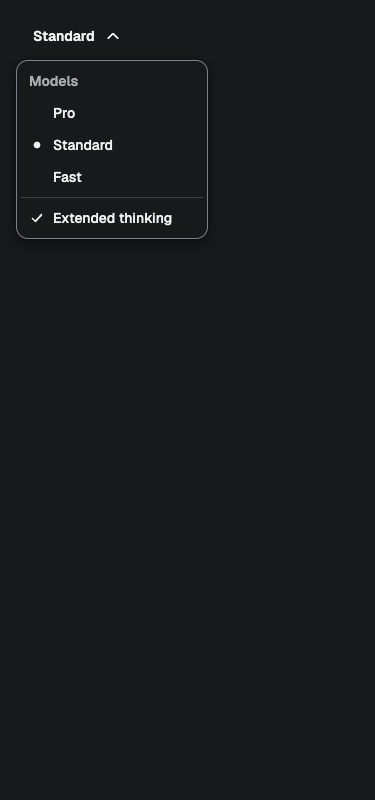
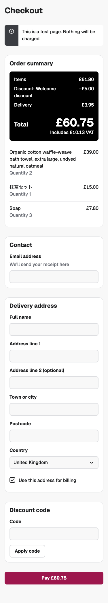
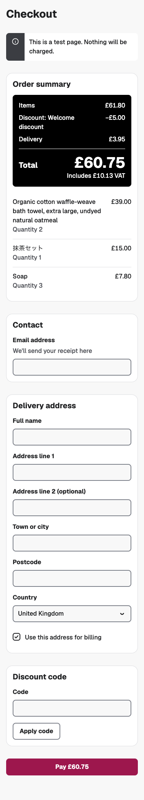
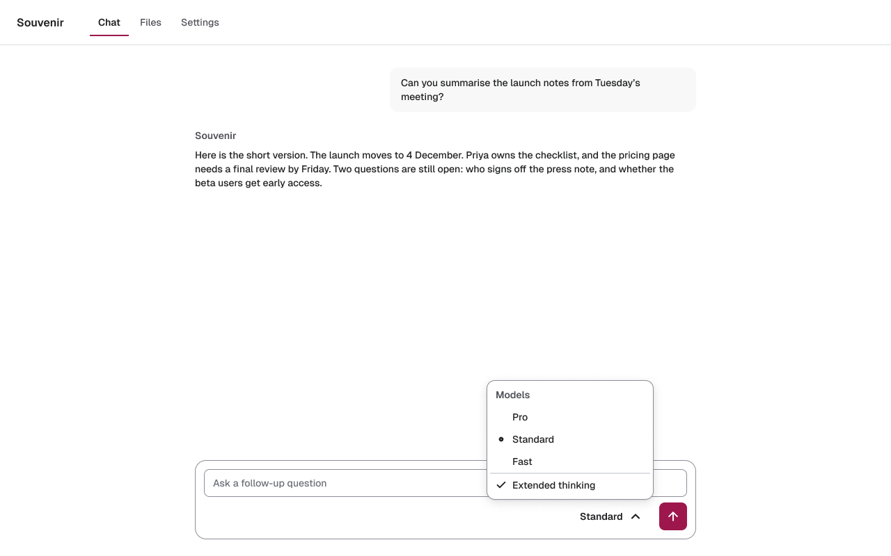
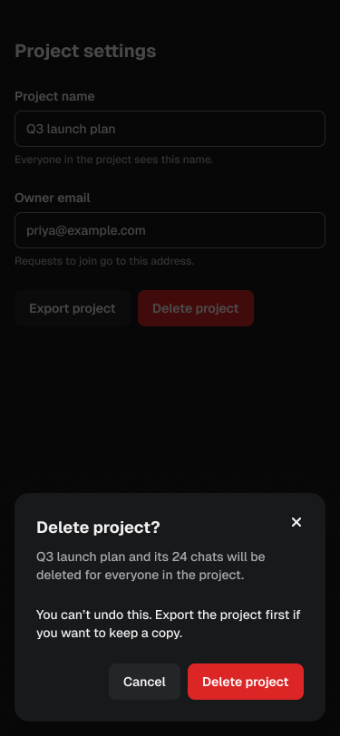

# Morning summary: the V2 direction, 16 November 2026

Your V2 direction is now a working chain on the branch `v2-direction`: an exact copy of your Figma tokens, a gate that checks them, a token package, five specified and built components, and the same thing rebuilt in your sandbox Figma file. Main is untouched. Your Semantic Tokens and Primitives files were read and never changed.

A fresh review at the end found one statement in my first draft of this summary that was wrong in a way that mattered, and 26 other faults. They are fixed, and the list is under "What the final review found". This is the corrected summary.

**To look at it**

- The report page, built from the tools' own numbers: `v2/report/index.html` (opens from disk).
- The three directions on real screens: run `npm run serve`, then open `http://localhost:4174/v2/screens/index.html`.
- The components: `npm run v2:gallery`, then `http://localhost:4174/ds-components/gallery/dist/index.html`.
- In Figma, in Souvenir-test: the pages "DS V2 · Tokens", "DS V2 · Components" and "DS V2 · Screens", each ending "(added by Claude)".

## Three decisions for you

1. **Put the fixes into your real Figma files.** 73 alias changes, 25 new variables and 290 descriptions are listed in `ds-tokens/audit/figma-patch-list.md`, each with its reason. I applied the same set in the sandbox, and the tools then find Figma and code in agreement on every variable. *Default taken: your files are unchanged; the repo carries the fixes in `ds-tokens/overrides.json` and `ds-tokens/proposed/`.* Say "apply it" and whether I may edit Semantic Tokens, or apply the list by hand.
2. **Pink beside red, and two things that rest on colour alone.** In dark, the primary fill (pink/600) and the destructive fill (red/600) have nearly the same lightness and chroma and sit about 27 degrees of hue apart. *Default taken: pink stays as you chose it.* A destructive button names what it destroys, and errors carry an icon and words. Two things still depend on colour: the soft destructive button differs from the others only in colour, and a link has the same colour as brand text in both themes once both pass contrast, so a link must keep its underline. If you would rather move a colour, say which.
3. **Finish the renames your own standard asks for, now or later.** The lint finds 24 kinds of breach of the standard in the Figma file. Eight of them are renames, covering 101 names: 30 size and radius names (small, base, radius by height), 31 typography prefixes that Tailwind will not turn into classes, 35 primitive names, 4 collection names and 1 name with a capital. The other 16 kinds are missing descriptions, scopes, raw values and states that share a value. Renaming is a breaking change, and cheapest before engineers build. *Default taken: nothing renamed; code uses the names Figma has today.*

## The token audit

| | As Figma stands | With the repo's fixes |
|---|---|---|
| Colour pairs that fail contrast | 220 of 740 | 0 of 760 |
| Pairs exempt, each with a reason | 52 | 52 |
| Naming findings | 66, in 24 kinds that break the standard | 48 in the sandbox copy, 14 kinds that break it |
| Figma and code agree | 258 of 308 tokens; the other 50 carry the fixes | every variable in the sandbox |

- **How a pair is chosen:** the token names say what meets what (text on the three surface tiers in every state, labels on fills, icons, control edges, the focus ring). The list is `v2/tools/contrast-pairs.json`.
- **Every fail fixed or explained:** all 220 failing pairs pass in the built set. Most fixes are the nearest step on the same colour ramp that passes; the others keep a pattern (hover lighter than rest, three link states apart, a bold icon the same in both themes), and each says so in its reason. Both sets and every pair that changed are in one page, `ds-tokens/audit/contrast.html`.
- **The 52 exempt pairs** are disabled states, dividers, and 8 focus-ring pairs beside a fill, where the ring is separated from the fill by a 2 pixel gap.
- **The figures in your message reproduce:** you gave 3.8 for brand text in dark and 3.3 and 4.2 for teal and blue bold text on hover; the audit measures 3.83, 3.32 and 4.24.
- **What your weak-spot list did not have:** accent text in dark was as low as 1.3 to 1; bold accent icons in dark were the 900 step on a 700 or 900 surface, as low as 1 to 1; the subtle neutral surface in dark was a light grey with text of the same grey on it.
- **Edge of an input:** `border/primary` is 1.35 to 1 against the page. It stays a divider; a new `border/strong`, at least 3 to 1 on all three surface tiers, is the edge of a control.
- **The 25 tokens Figma lacks** (border widths, focus ring, control and icon sizes, motion, shadows, a scrim, the strong edge, two stacking levels) hold raw numbers. Your standard asks every semantic token to point at a primitive, and no primitive exists yet for a width, a size, a duration or a level. Adding those primitives is a step for your file.
- **Left on purpose:** the lint marks four pairs of states that share one colour, such as a hovered and a disabled secondary surface. One shows in a component: a disabled Button has the same fill as a hovered secondary Button, and is told apart by its dim label alone.

## The five components

Each has a spec (`ds-components/specs/`), a stylesheet and typed props generated from it, a React component on Radix, examples, and a browser test for every requirement that names one.

| Component | Checks passed | Failed | Not reached, or for a person |
|---|---|---|---|
| Button | 689 | 0 | 2 |
| Input | 670 | 0 | 5 |
| Tabs | 683 | 0 | 3 |
| Dialog | 487 | 0 | 43 |
| DropdownMenu | 583 | 60 | 5 |

- **What a check is:** the runner opens every example in a real browser, in light and dark, at 320 and 1280 pixels. It drives each state the spec lists and checks that the state's selector matches; where the spec names a colour for that state, it also compares the rendered colour with the token. Of the 536 state checks that pass, 194 compared a colour and 342 matched the selector only. It runs axe, measures contrast, target size and the focus ring, and runs the 135 tests that requirements name, such as "Escape closes the dialog and focus returns to the trigger".
- **The 60 failures are one finding.** In Radix's default modal mode, the page behind an open menu is hidden from assistive technology while the menu's trigger, inside that page, is still focusable in the markup (axe rule `aria-hidden-focus`). Measured: focus cannot reach the trigger by key, pointer or script while the menu is open. It is left failing and reported, not exempted. Whether to ship menus modal or not is Kunal's call.
- **Dialog's 40 "not reached":** Radix removes a closed dialog from the page at once, so its closed state cannot be seen. The runner says so instead of counting it as a pass.
- **States mapped to Radix attributes:** `ds-components/docs/state-map.md`. Tabs selected is `[data-state="active"]`; a menu item's hover and focus are one state, `[data-highlighted]`; Input's Figma states placeholder, filled and error map to `:placeholder-shown`, its negation and `[data-invalid]`. All 21 Figma values in that map are marked not confirmed: I could read only a stale cached copy of your components.
- **Script size:** each component's own code is 1 to 2.5 kilobytes compressed. With Radix bundled, Tabs is 10.7, Dialog 15.6 and DropdownMenu 33.0 kilobytes, against 5 in version 0.2's budget. You have not set a budget for React components, so this is reported, not failed.

| Menu | Dialog | Input | Tabs |
|---|---|---|---|
|  |  |  |  |

## The same screens in three directions

Version 0.2's checkout and assistant, as built; with only what your Figma file holds; and with the merged tokens.

| Version 0.2 | V2 as given | Merged |
|---|---|---|
|  |  |  |
|  |  |  |

| Page states that pass, of 8 (four screens, light and dark) | V2 as given | Merged |
|---|---|---|
| Text contrast | 8 | 8 |
| Edge of a field at 3 to 1 | 0 (1.35 to 1 in light, 1.67 in dark) | 8 |
| Every target at least 24 pixels | 4 | 4 |

- **What the difference is:** the two columns look almost the same, except that the edges of fields nearly disappear in yours. The tokens that fail text contrast in Figma (status text, accent text, placeholder, links on grey) are ones these two screens barely use.
- **What "as given" had to borrow:** Figma holds no size, border-width, focus-ring or motion tokens, so that column uses nine literal values, listed on the page. They equal the merged column's, so the two differ only in colour.
- **The target failure is mine:** the billing checkbox is 20 pixels square in both columns, measured without counting its label. Checkbox is not one of the five components.

## In your sandbox, Souvenir-test

**Added, and nothing that was there before edited or deleted** (full list with ids: `v2/figma/sandbox/CHANGES.md`):

- 13 variable collections, 523 variables, named "… (DS V2)" and "… (DS V2 primitives)". Every semantic variable has a description and web code syntax; primitives are hidden from pickers.
- 2 effect styles, "shadow/md (DS V2)" and "shadow/lg (DS V2)".
- Page "DS V2 · Tokens (added by Claude)": every colour role in light and dark, the type, radius and spacing scales.
- Page "DS V2 · Components (added by Claude)": Button (114 variants), Input (21), TabsTrigger (20), DropdownMenuItem (14), DialogContent (2), three menu parts and nine icons, generated from the specs. A read-back found all 3,623 bindings on the variable the spec names, and no raw value. The read was taken at 19:44 UTC on 16 November, after the last change to the file.
- Page "DS V2 · Screens (added by Claude)": the two screens above, each in light and dark. The two pictures here were taken before the last colour changes; in light, field edges are now one step darker.
- **Changed later the same day, all among my own additions:** two variables renamed (`focus/width` and `focus/offset` to `ring/width` and `ring/offset`); then, after the review, 15 colour variables re-pointed (bold teal and blue surfaces, nine bold accent icons, the strong edge, the success edge), `duration/base` renamed `duration/enter`, one description rewritten, and a new collection "Layer (DS V2)" with two variables.

Two things I read differ from what I expected. The variable Background/Inverse in Souvenir-test is `#000000` in light, not `#0040ff`; the blue may be set by hand on layers. And Figma stores an apostrophe in a description as the characters `&#39;`, so descriptions I write use a typographic apostrophe.

## Your direction and mine, and the merge

The full table, topic by topic, is in the report page and `v2/report/comparison.json`. In short:

- **Yours is stronger on:** the vocabulary (308 tokens in the product's own words against 68 in mine), writing a name once in Figma, React on Radix with the names engineers already use, and the brand.
- **Mine was stronger on:** a gate that stops a bad value shipping, contrast, the edge of a control, tokens for border widths, sizes and motion, and proof in a browser that a component does what its description says.
- **Merged:** your names and values, unchanged, as the public names; my gate between Figma and code; a spec per component from which styles, types, docs and tests are generated.
- **On the first five:** the earlier handoff chose them because they are on most screens and their Figma colour is already 75 to 98 percent on semantic tokens. They are not the five most used: Tooltip (87 files) and Badge (70) are used in more files than Dialog, Input or Tabs, and wait only for their Figma colour to be rebound.

**What hurts accessibility, agent-readiness or the build, in your direction as given:**

- **Accessibility:** the 220 failing pairs; the input edge at 1.35 to 1; body text at 14 pixels in a text field, which makes iOS zoom the page (the merged Input uses 16 on a touch screen); controls 32 and 40 pixels tall on a phone (merged: at least 44 where the pointer is a finger); 10 pixel type roles.
- **Agent-readiness:** 290 of 308 tokens have no description, which is what an agent reads through the Figma connector (all 290 are drafted in `ds-tokens/descriptions.json`); typography variables are open to every scope; the Geist font has no Japanese, Chinese or Korean glyphs, so those fall back.
- **The build:** font size, line height and font family carry prefixes Tailwind v4 does not read as utilities (`--font-size-` where it wants `--text-`); the generated Tailwind theme maps them, but it has not been compiled with Tailwind here. The stylesheets must load in one order or Tailwind's reset strips Button and Input; the order and a snippet are in `ds-tokens/README.md`. "v0.1.0 until 1.0" sits beside a table in the same standard in which a rename is a major change; and in this repo the tag 0.1.0 is already taken by the archived build.

Where each quoted figure and rule comes from is recorded in `notes/sources/2026-11-16-v2-one-pager-and-naming-standard.md`.

## What it can grow into

The map is in the report page (`v2/report/growth-map.json`): seven lanes (tokens, components, product patterns, pipeline, agents, platforms, proof with people) across now, next and later. Next in line: Spinner, Sheet, Avatar and Chip; then Tooltip and Badge once their Figma colour is rebound; then the Composer and the model selector as patterns.

## What the final review found

Three fresh reviewers read the claims, the components and the tokens. All three returned "pass with fixes": 1 blocker and 26 major findings. What was wrong, in plain words:

- **The "V2 as given" screens were not as given.** They used my own edge and size tokens, so your direction passed an edge check it fails. That column is rebuilt from Figma alone and re-measured; the table above is the result.
- **Dialog at 200 percent text lost its buttons** on a phone, and a dialog that cannot be dismissed became a trap. Fixed: under a small height the whole dialog scrolls, and focus never lands out of view.
- **Nothing set a stacking level,** so any page element with a z-index painted over an open dialog or menu. Fixed with two tokens.
- **A Dialog opened from a menu item dropped focus** to the page on close. Fixed: it returns to the menu's trigger.
- **A disabled Button rendered as a link still ran the link's own click.** Fixed.
- **An Input marked invalid with an empty message showed no error.** Fixed.
- **Vertical Tabs squeezed their panel to 1 pixel** at 200 percent text on a phone. Fixed: the panel moves below the list.
- **Two of my colour fixes made hover go darker** where every other hue goes lighter, and 15 fixes changed values that already passed. Corrected.
- **The strong edge failed on the third surface tier** (2.86 to 1). Corrected.
- **The naming lint missed four kinds of breach** and had no rule for the standard's rule 2. Four rules added.
- **Tools overwrote each other's reports,** and several numbers I had typed by hand were stale. Sandbox runs now write to their own folder, and a new check compares the numbers written in this summary with the tools' output.

**Left open, on purpose:** a look for a disabled menu item in forced-colours mode; a way to set right-to-left on one instance; what Tabs do when the selected tab is removed. And from the review's notes on handing this to engineers: no pull request is open, the two packages have no `package.json` of their own, the token build is my own script, not Style Dictionary, and Storybook is not installed.

## What failed earlier, and what is not proven

- **My first Button spec was wrong twice.** A label that wrapped did not fit its fixed height, and a loading button looked disabled. The pilot's tests caught both.
- **The four specs came back in four dialects.** Written in parallel, they keyed props three different ways and one replaced Radix's parts with a wrapper. I settled one convention and had each revised.
- **The runner was too generous, then too strict.** It first counted a removed dialog as "closed", and failed a text field for having its focus ring on its container. Both are fixed, each with a planted case that proves the check still catches the real fault.
- **Not proven:** nothing was tested with people, a screen reader or a real phone; only Chromium was used, and 200 percent text was emulated through the root font size. The Figma properties of your live components could not be read, so every Figma-to-code state mapping is marked not confirmed. The Tailwind theme is generated and not compiled. Dark shadows are not carried in the sandbox, because a Figma effect style holds one value.
- **Version 0.2 still passes its own suite** (`npm run check`, exit 0). Its ten parts are not yet re-pointed at the new tokens; the comparison screens do it through a bridge stylesheet.

## Where the system stands, what I'd aim for, what I'd want from you

- **Stands:** the tokens were the system, and nothing checked them. Now a name is written once in Figma, copied exactly, checked, and generated into code; five components run through that chain with specs and tests. No person has used any of it.
- **Aim:** make the gate the normal path. A change in Figma becomes a snapshot, a report of what it breaks and a pull request an agent opens and a person merges. Then the next nine components, then version 0.2's parts on the new tokens.
- **From you:** access to the Souvenir DS Components file; an answer on the three decisions; a look at the app repo or Kunal's constraints (Tailwind version, how the theme is switched, where the package lives).

## The numbers, each from a command

| What | Result | Command |
|---|---|---|
| Figma snapshot is exact | 314 and 229 lines, every block matches | `node v2/tools/figma-verify.mjs v2/figma/semantic.txt v2/figma/semantic.hashes.txt` (and primitives) |
| Contrast, Figma as it stands and built | Figma: 740 measured, 468 pass, 220 fail, 52 exempt. Built: 760 measured, 708 pass, 0 fail, 52 exempt | `node v2/tools/audit-contrast.mjs --built` |
| Naming lint, your file | 22 rules, 66 findings, 24 kinds break the standard | `node v2/tools/lint-tokens.mjs --no-fail` |
| Figma against code | 258 of 308 agree, 0 drift, 73 overrides, 25 not yet in Figma | `node v2/tools/diff-figma.mjs` |
| Sandbox against code | 331 of 331 variables agree, 0 drift; the two shadows are effect styles, not variables | `SOUVENIR_SNAPSHOT_DIR=v2/figma/sandbox node v2/tools/diff-figma.mjs` (writes to `v2/figma/sandbox/audit/`) |
| Specs | 5 specs, 70 checks, 0 findings | `node v2/tools/check-specs.mjs` |
| Components in the browser | 84 examples, 3,230 checks: 3,112 pass, 60 fail, 58 not reached or for a person | `npm run v2:test` |
| Component lint and types | 0 errors | `npm run v2:lint` |
| Figma read-back | 174 variants, 3,623 bindings, 0 mismatches, 0 raw values | `node v2/tools/figma-readback-check.mjs v2/figma/sandbox/readback-parts/01-all.json` |
| Every tool proves itself on planted faults | exit 0 | `npm run v2:selftest` |
| Numbers written in this summary match the tools | 0 mismatches | `npm run v2:claims` |
| Token stylesheet, compressed | 4,757 bytes | `gzip -9 -c ds-tokens/dist/tokens.css \| wc -c` |
| Version 0.2's suite | exit 0 | `npm run check` |

`npm run v2:check` runs tokens, specs, lint and the browser tests in one go; it exits 1 while the menu finding stays open.

Subagents used about 12.7 million model tokens on this work, as the tools reported them: about 9.5 million to build, 1.7 million for the final review and 1.5 million for its fixes. My own tokens are not reported to me and are not included.
